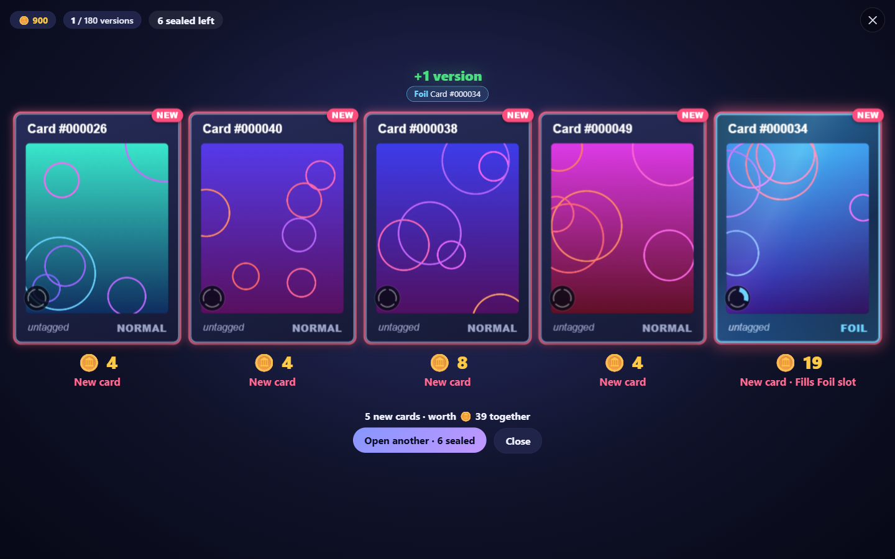
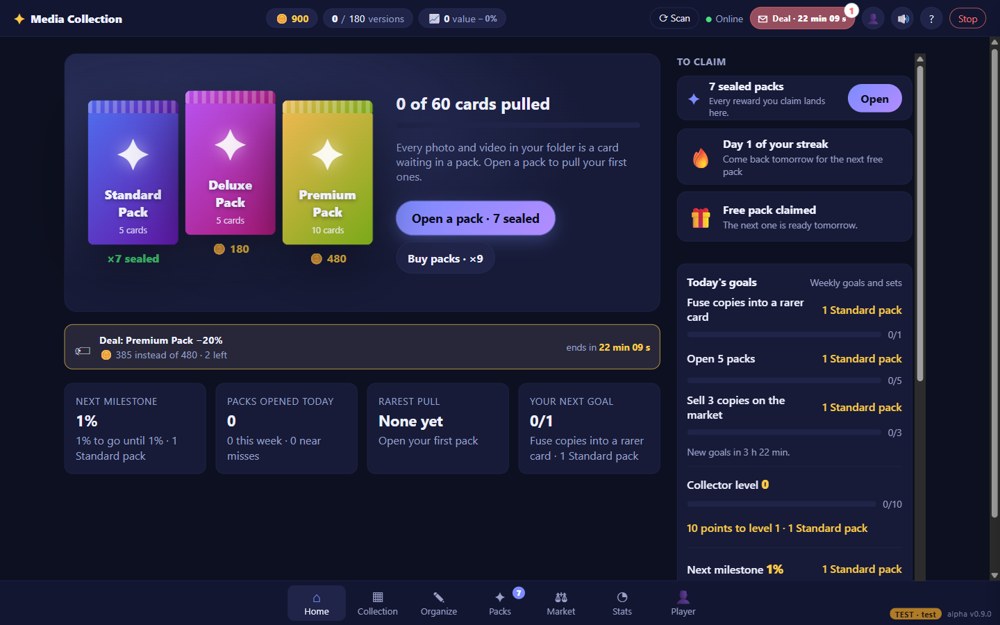
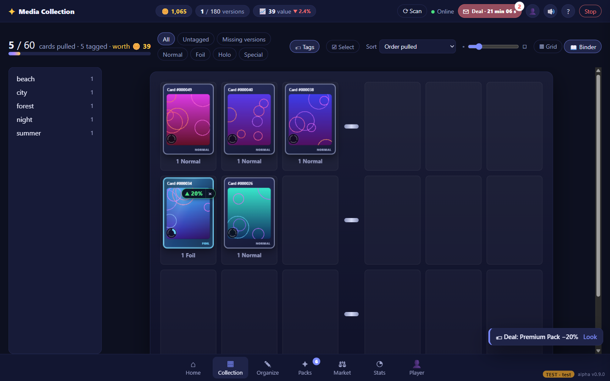
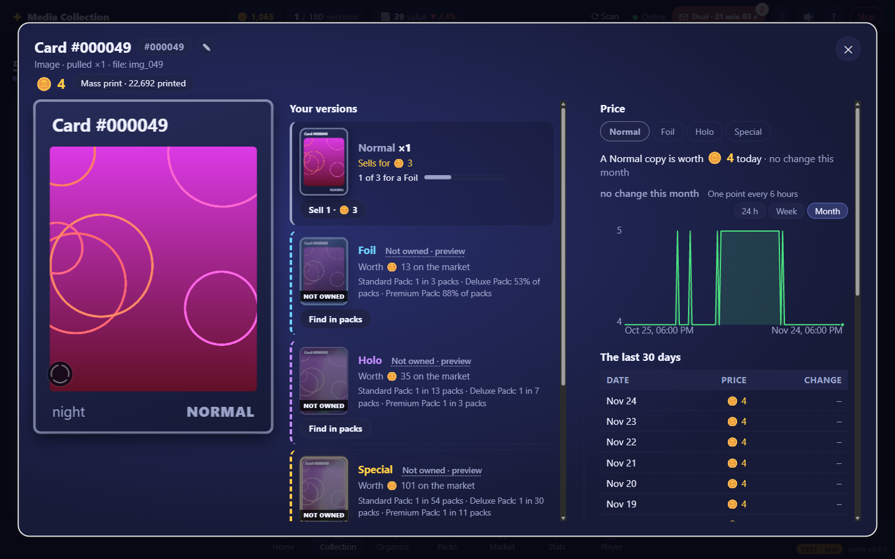

# Media Collection Organizer

**Turn a folder of photos and videos into a trading-card game you play to get it organized.**

Sorting and tagging thousands of files is dull work. This app makes it a game. Every photo and video in your folder becomes a collectible card. Cards come out of sealed packs, some of them in rarer, shinier versions. You earn coins by tagging the cards you pulled, and you spend the coins on more packs. While you play, your library gets tagged.

Everything runs on your own computer. Your files are never moved, changed or uploaded, and there is no account.

> **Alpha 1 (v0.9.0).** The game is playable from start to finish for one player on Windows. It is an early version: numbers and screens still change between versions, and a newer version may ask you to reset your progress; your files are never touched.



| | |
|---|---|
|  |  |



## How it plays

1. **Choose your media folder.** The app scans it and makes one card for every photo and video.
2. **Open packs.** You start with 500 coins and get one free pack a day. A pack shows five or ten of your own files as cards, face down, and you turn them over.
3. **Tag what you pulled.** Every tag pays coins, and a rarer card pays more. Adding new files to the folder pays too.
4. **Buy more packs** with the coins, and collect the rare versions of every card.

Coins come only from tagging and from scanning in new files. Everything else in the game (goals, levels, milestones, sets) pays in sealed packs.

## Features

### Cards and packs
- **Four versions of every card:** Normal, Foil, Holo and Special, each with its own look. Foil and Holo cards shimmer and tilt under the pointer; video cards play inside the card.
- **Three packs** on a ladder (Standard, Deluxe, Premium) with odds modelled on real booster packs. Every pack has the same odds, every time.
- **A full-screen pack opening:** face-down cards with a glow that hints at what is under them (and is sometimes wrong), a flip with its own timing for every card, sound and screen effects that grow with the rarity.
- **Sealed packs are kept** until you open them, one at a time or ten in a row.

### Your collection
- **Collection grid** that stays fast with thousands of cards, with filters, sorting and a card-size slider.
- **Binder view** with nine pockets a page, and a Versions mode that shows all four versions of one card.
- **A version count that is always in view:** "187 / 720 versions" in the top bar, a ring on every card that shows which versions you hold, and a list of the cards that miss one.
- **Card panel:** all four versions, tags, the price and its history, and a full-screen view of every version.
- **Every card has a permanent number** ("Card #000412") and can be given a name of your own. Files on disk are never renamed.

### Organizing
- **Organize mode** for tagging with the keyboard: nine quick tags on the keys 1 to 9, suggestions while you type, batches of 10, 20 or 50 cards.
- **Tags in categories**, a tag browser, and bulk tagging.
- **A tag added by mistake** is removed with one click, and its coins go back.
- **A daily tag rush:** ten minutes in which every tag pays double.

### The card market
- **Every card has a market price** that follows how scarce and how popular it is. A few cards are worth far more than the rest, as in real card sets.
- **Prices move every six hours**, also while the app is closed, with hypes, buyouts and reprints.
- **Sell copies you do not need**, buy the most valuable cards of each version, or take an offer from a collector.
- **Merge copies** of one version into one copy of the next.

### Goals
- **Daily and weekly goals**, a collector level, category sets and completeness milestones. They pay sealed packs.
- **A daily check-in** with a free pack, and a Home page that always names your next goal.
- **Messages** for collectors' offers, wanted cards and the shop deal.

### The app
- **One click to start**, a first-run setup screen, guided tours and a built-in help window with guides and a FAQ.
- **A Player page** with your history and settings, and a reset of the game that keeps your library.
- **Reduced motion and a global mute** are respected by every effect and sound.

## Getting started (Windows)

You need **Python 3.12 or newer** and **Node 20 or newer** on your PATH.

1. Download or clone this repository.
2. Double-click **`start.bat`**. The first start installs what the app needs; after that it opens the app in your browser.
3. Press **Choose folder…** and pick the folder with your photos and videos.

| File | What it does |
|---|---|
| `start.bat` | Starts the app and opens your browser. It stops by itself shortly after you close the last tab. |
| `start-dev.bat` | The same, but it keeps running when the tabs are closed. |
| `start-test.bat` | Starts a separate test profile with its own database and folder, for trying things out. |
| `setup.bat` | Installs or updates what the app needs. |

Stop the app with the **Stop** button in the top right corner, or close the console window. After adding files to your folder, press **⟳ Scan** in the top bar: the app never scans by itself.

## Your files and your data

- The app only reads your media folder. It never moves, renames, changes or deletes a file.
- Nothing leaves your computer. There is no account, no telemetry and no online service.
- Your progress is kept in a local database in the `data` folder. Thumbnails and two days of logs are kept there too.

## A word on the design

The app borrows habit-forming mechanics from card games on purpose: variable rewards, staged reveals, near misses, streaks and timers. They are meant for the one owner of a personal tool who wants tagging to be fun. They can also make you spend more time than the organizing needs.

## Built with

Python (FastAPI, SQLAlchemy, SQLite) on the server side and TypeScript with Vite in the browser, with no UI framework. Every number of the game's economy is in `config/economy.toml` and can be changed while the app runs.

```sh
# Run the checks
cd backend && .venv/Scripts/python -m pytest
cd frontend && npm test
```
